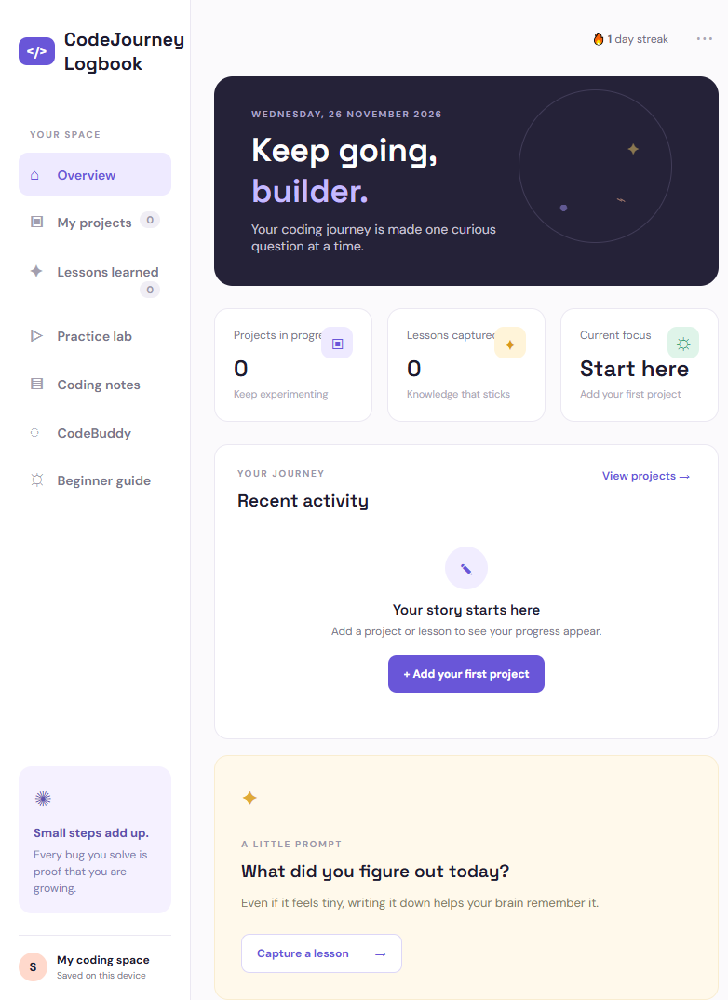

# CodeJourney

CodeJourney is a beginner-friendly coding journey app for tracking projects, saving lessons, reading simplified coding notes, practicing JavaScript and Python, and asking CodeBuddy for help.

## Website preview

## Features

- Track coding projects and lessons learned
- Read simple notes with examples
- Practice JavaScript and Python in a VS Code-style lab
- Get beginner-friendly help from CodeBuddy
- Save progress in the browser on your device
- Install it on a laptop as a standalone app from the **Install app** button

## Privacy and safety

CodeJourney stores projects, lessons, and roadmap progress locally in the browser. It does not require accounts or passwords. The practice lab runs JavaScript in a separate worker with a time limit. Do not paste passwords, private keys, or other sensitive information into the lab.

## Run it

Open [`index.html`](./index.html) in a web browser.

## Live repository

Visit the [CodeJourney Logbook GitHub repository](https://github.com/fdemo1394-gif/codejourney-logbook).

## Publish the installable website

The repository includes an automatic GitHub Pages workflow. The repository owner must enable Pages once:

1. Sign in to GitHub and open **Settings → Pages** for this repository.
2. Set **Source** to **GitHub Actions** and save.
3. Wait for the **Deploy CodeJourney Logbook** workflow to finish.
4. Open https://fdemo1394-gif.github.io/codejourney-logbook/ and choose **↓ Install app**.

The workflow will deploy future updates automatically.

## Contact

For feedback or questions, email [fdemo1394@gmail.com](mailto:fdemo1394@gmail.com).
